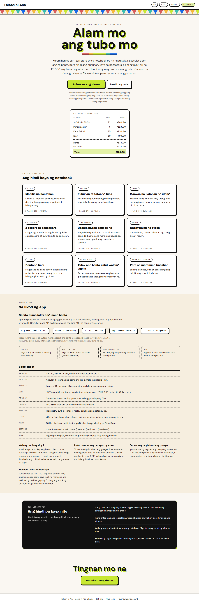
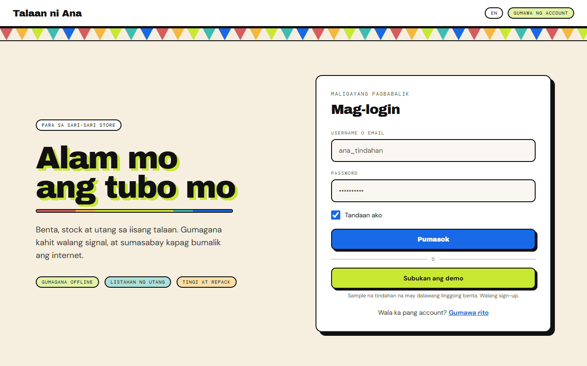
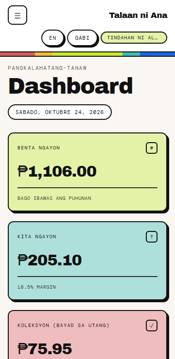
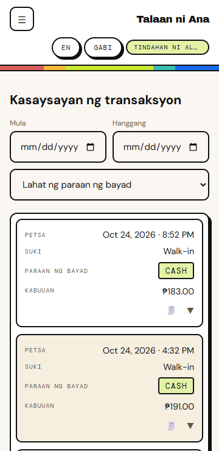
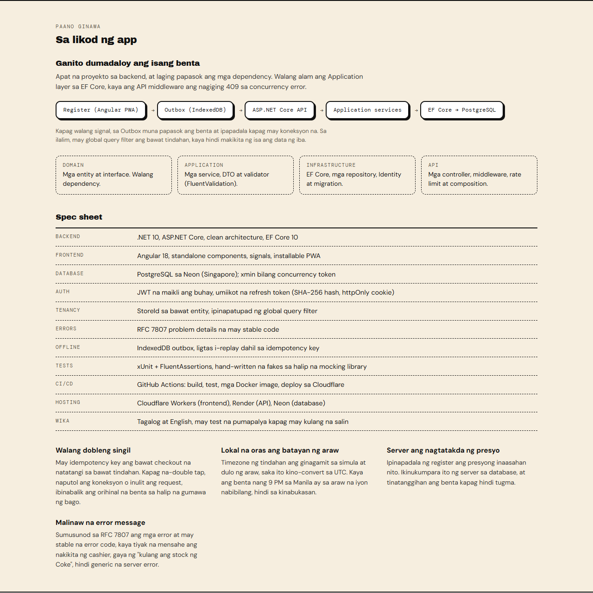
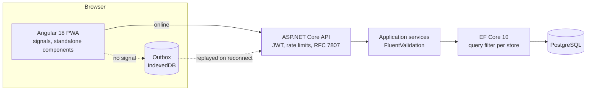

# Talaan ni Ana

A multi-tenant point of sale for Philippine sari-sari stores, built around the thing a
paper notebook cannot do: tell the owner how much of the day's takings was actually
theirs.

Built with .NET 10, Angular 18 and PostgreSQL.

**[Live demo](https://talaanniana.irreversiblechain.workers.dev)** — click *Subukan ang demo*,
or create your own store.

The demo runs on free hosting that sleeps when idle, so the first request after a quiet
period takes up to a minute while the API and the database wake. It is seeded with one
store that has eighteen products, five customers carrying utang, and a fortnight of sales,
so the screens have something in them.



| The till | On a phone | Transactions on a phone |
|---|---|---|
|  |  |  |

## Why profit, and not just sales

A sari-sari store's notebook records what was sold. It does not record what the stock cost,
so at the end of the day the owner knows three thousand pesos came in and has no idea how
much of it was margin. Stock moves, prices change, and the answer drifts.

Talaan ni Ana records a cost price per item and **snapshots it onto every sale line**:

```csharp
new TransactionItem
{
    UnitPrice = product.Price,
    UnitCost  = product.CostPrice   // snapshot, so a later cost change
}                                   // does not rewrite past profit
```

So when a supplier raises the price of Coke next week, last week's profit stays what it
actually was. The dashboard, the Z-report and the inventory list all read from the same
snapshot rather than recomputing against today's cost.

Loss leaders are allowed, because stores really do sell salt below cost to pull people in.
They show as negative margin rather than being rejected.

## What it covers

| Area | What it does |
| --- | --- |
| **Benta** | Barcode scanning, quick-tap tiles, per-line quantity stepper, cash or utang |
| **Imbentaryo** | Cost and margin per item, per-product low-stock thresholds, search by name or barcode |
| **Suki** | Utang per customer, part payments, balances recomputed from the ledger |
| **Dashboard** | Today's sales and profit, month-to-date margin, top sellers and most profitable |
| **Stock** | Movement ledger per item: delivery, count correction, spoilage, return, repack |
| **Tingi** | Break a pack into pieces; cost per piece derived from the pack's own cost |
| **Lugi sa Sira** | Spoilage and shrinkage valued at cost, ranked by which items keep going |
| **Z-report** | End-of-day close: expected cash in drawer, gross profit, utang movement |
| **Settings** | Store name, timezone, low-stock default, Tagalog or English |

## Barcode scanning without a scanner library

A USB barcode scanner is a keyboard. It types the code and presses Enter. So the till keeps
a focused input and looks up the code on Enter, which means no dependency, no camera
permission, and typing a code by hand works identically when the scanner is unplugged.

Codes are unique per store among active products, so a deleted item releases its barcode
for reuse.

## Selling without a connection

Signal is not a given, and a till that stops working is worse than a notebook. Sales rung
up offline are held in IndexedDB and sent when the connection returns.

Replaying them is safe because of something already built: every checkout has always
carried an idempotency key, so a sale the server already recorded comes back as the
original rather than being rung up twice. The offline queue is that guarantee used for
what it was for.

Two distinctions the queue depends on:

- A **network failure** stops the flush. Nothing else will get through either, so there is
  no point burning through the queue to collect the same error.
- A **4xx** is final. The server heard the sale and refused it, so retrying changes
  nothing; it surfaces to the cashier instead of sitting in the queue forever.

`navigator.onLine` is treated as a hint rather than an answer — it reports the network
interface, not whether the API is reachable — so a real request is what settles it.

## Stock has a reason

Stock used to be a number that changed. Now every change writes a ledger row with a reason,
a signed quantity and the balance it left behind.

The balance is stored rather than recomputed, so a correction entered next week cannot
rewrite what the owner saw at the time. Quantities are signed, so the balance is a sum over
one column with nothing to get the wrong way round. Sale movements survive the deletion of
the sale that caused them.

Repacking writes both halves in one transaction: a pack goes out, the pieces come in, and
cost flows down as the pack's cost divided by what it yields. A pack with no recorded cost
leaves the piece cost alone rather than writing a confident zero over a real figure. One
level only — a sack to a cup is repacking, a sack to a cup to a spoonful is a supply chain.

## Architecture





| | |
| --- | --- |
| Backend | .NET 10, ASP.NET Core, EF Core 10, FluentValidation, Identity |
| Frontend | Angular 18, standalone components, signals, service worker, ngx-charts |
| Database | PostgreSQL 17 (Neon in production), `xmin` as the concurrency token |
| Auth | Short-lived JWT, rotating refresh tokens in an httpOnly cookie |
| Tests | xUnit and FluentAssertions on the backend, Karma and Jasmine on the frontend |
| CI/CD | GitHub Actions: build, test, Docker images, deploy to Cloudflare Workers |
| Hosting | Cloudflare Workers (web), Render (API), Neon (database) |
| Languages | Tagalog and English, with a test that fails when a text is missing in one |

Four projects, dependencies pointing inward:

```
backend/TalaanNiAna.Domain          entities, interfaces, no dependencies
backend/TalaanNiAna.Application     services, DTOs, validators
backend/TalaanNiAna.Infrastructure  EF Core, repositories, Identity
backend/TalaanNiAna.API             controllers, middleware, composition
backend/TalaanNiAna.Tests           xUnit, against hand-written fakes
frontend/talaan-ni-ana              Angular app: features/, core/ (auth, i18n, offline), shared/
docs/                               CI, database, deployment, demo, offline, testing
```

The Application layer deliberately knows nothing about EF Core. `CheckoutService` does not
catch `DbUpdateConcurrencyException`; it lets it surface so the layer stays free of the
persistence library, and the API middleware maps it to a 409.

### Multi-tenancy

Every tenant-owned entity carries a `StoreId`, and `AppDbContext` applies a global query
filter to each one:

```csharp
entity.HasQueryFilter(p => p.StoreId == CurrentStoreId);
```

`CurrentStoreId` reads the store claim from the current request's token, and falls back to
zero when there is no request, which matches no rows rather than leaking another store's
data. New rows are stamped in `SaveChanges`, so no repository has to remember to set it.

The point is that a query is scoped by default rather than by discipline. Forgetting a
`where` clause on a new feature returns nothing instead of returning everyone's data.

`TransactionItem` carries its own `StoreId` rather than relying on its parent transaction,
because the reporting queries read that table directly and a filter on a navigation would
not cover them.

### Things that are easy to get wrong, and how they are handled

**Selling the same last piece twice.** Products carry an optimistic concurrency token, which
on PostgreSQL is the `xmin` system column rather than a column of our own. Two tills
decrementing the same stock means the second `SaveChanges` throws, and the sale is rejected
rather than overselling.

**Ringing up a sale twice.** Each checkout attempt carries a client-generated idempotency
key, unique per store. A double tap, a dropped connection or a retry returns the original
transaction instead of creating another one.

**Trusting the browser's prices.** The till sends what it believes each price is. The server
compares that to the database and rejects the sale if they disagree, so a tampered request
cannot buy at a price of its choosing.

**The sales day in the wrong timezone.** Day boundaries are resolved in the store's own
timezone and converted to UTC windows, so a 9pm sale in Manila lands on the day it was made
rather than the next UTC one. This is also why the connection string pins `Timezone=UTC`.

**Drifting balances.** A customer's `TotalCredit` is recomputed from transactions minus
payments rather than incremented, so the cached figure cannot drift away from the ledger.

**Useless errors.** Every handled failure returns an RFC 7807 problem document with a stable
code, so the cashier sees "kulang ang stock ng Coke Mismo" rather than a generic 500.

### Authentication

Short-lived access tokens, with rotating refresh tokens stored as SHA-256 hashes in an
httpOnly cookie. Presenting a refresh token that has already been used revokes the whole
family, on the assumption that it leaked. The access token is held in memory only, so an
XSS payload cannot read it from storage.

## Things worth knowing

**The phone is the main screen.** A till is used one-handed behind a counter, so below 860px
the sidebar becomes a drawer, and the wide tables (inventory, customers, transactions)
become stacked cards whose labels come from `data-label`, keeping each one a single table in
the markup. Nothing scrolls sideways at 360px; that was checked in a real browser at 360,
768 and 1280px rather than assumed.

**Charts load lazily.** `provideAnimationsAsync()` keeps `@angular/animations` out of the
landing page's initial bundle, which is about 110 kB over the wire.

## Running it locally

```bash
docker compose -f docker-compose.dev.yml up -d
```

That starts PostgreSQL on port 5433, chosen to stay clear of a natively installed
PostgreSQL on 5432. Wait for `docker compose -f docker-compose.dev.yml ps` to read
`healthy`.

```bash
cd backend/TalaanNiAna.Infrastructure
dotnet ef database update --startup-project ../TalaanNiAna.API

cd ../TalaanNiAna.API
dotnet user-secrets set "Jwt:Key" "$(openssl rand -base64 48)"
dotnet run --launch-profile https
```

```bash
cd frontend/talaan-ni-ana
npm ci
npm start
```

Then open `http://localhost:4200`.

To seed the demo store locally, add two more secrets before running the API:

```bash
dotnet user-secrets set "Demo:Enabled" "true"
dotnet user-secrets set "Demo:Password" "Demo2026pass"
```

### The whole stack in one command

```bash
cp .env.example .env    # fill in POSTGRES_PASSWORD and JWT_KEY
docker compose up --build
```

That brings up PostgreSQL, the API, and nginx serving the built frontend and proxying
`/api` to the API, so the browser sees one origin and CORS does not apply. Open
`http://localhost:8080`.

The hosted demo is arranged differently, because free hosting gives each service its own
domain: the API on Render, the database on Neon, and the frontend on Cloudflare Workers.
There the frontend holds the API's absolute URL and the API allows that origin explicitly.
`frontend/talaan-ni-ana/src/environments/environment.ts` says which arrangement is in use.

Migrations are applied on startup where `Hosting:RunMigrationsOnStartup` is set, because the
free tier has no shell to run `dotnet ef` from. That is convenient rather than correct, and
`docs/DEPLOYMENT.md` says why.

## Deployment

Both images are built on every push and pull request, so a broken Dockerfile fails in CI
rather than at deploy time. On a merge to `main`, Render rebuilds the API by itself and the
workflow publishes the frontend to Cloudflare Workers, so both ends move together.

See `docs/DEPLOYMENT.md` for the environment variables, `docs/DATABASE.md` for the
PostgreSQL specifics, and `docs/DEMO.md` for what the demo seeds.

## Testing

```bash
cd backend
dotnet test            # 50 tests

cd frontend/talaan-ni-ana
npm test               # includes the translation completeness check
```

The suite covers the pieces that hold real logic:

- **Checkout**: price tampering rejected, insufficient stock rejected, idempotent replay
  returning the original sale, cost snapshotted at the moment of sale, loss leaders
  recording negative profit.
- **Z-report**: expected drawer excluding credit sales, margin arithmetic, net utang
  movement, an empty day returning zeros rather than dividing by it, a future date refused.
- **Barcode**: lookup, scanner whitespace, duplicates rejected, a product keeping its own
  code on edit, an empty string clearing it.
- **Store clock**: day and month boundaries resolved in the store's timezone, including a
  sale just after local midnight.
- **Stock ledger**: sales writing movements, a manual sale reason refused, spoilage that
  adds stock refused, balance carried forward, shrinkage valued at cost.
- **Repacking**: both halves written, cost derived from the pack, an unlinked product
  refused, a pack short of stock refused.

Tests run against hand-written stateful fakes rather than a mocking library, because they
assert on the state left behind rather than on which calls were made.

## Known limitations

Recorded deliberately rather than left to be discovered.

- **No integration tests.** Every test runs against in-memory fakes, so nothing exercises a
  real query. The move to PostgreSQL made that concrete: `Contains` is case-insensitive on
  SQL Server and case-sensitive on PostgreSQL, and no test would have caught search quietly
  breaking. Tests against a throwaway database container are the gap.
- **Offline selling is one-way.** Sales queue and send, but the catalogue is only as fresh
  as the last time the app was online, and a price changed on another device will not be
  known. Two tills selling the same last piece offline both succeed locally and one fails
  on sync, which is correct but unhelpful.
- **Repacking is one level deep.** A pack can be broken into pieces, but a piece cannot be
  broken again. That is deliberate rather than pending, but it is a limit.
- **Migrations applied at startup.** Fine for a single free instance, wrong the moment there
  are two: both would try to migrate on boot.
- **The demo is writable by anyone.** Visitors can add products and ring up sales, and
  nothing resets it, so it drifts from the seeded state.

## Roadmap

- Integration tests against a throwaway PostgreSQL container.
- Offline catalogue refresh, so a price changed on another device reaches a till that was offline.
- A reset for the shared demo store.

## Licence

MIT.
